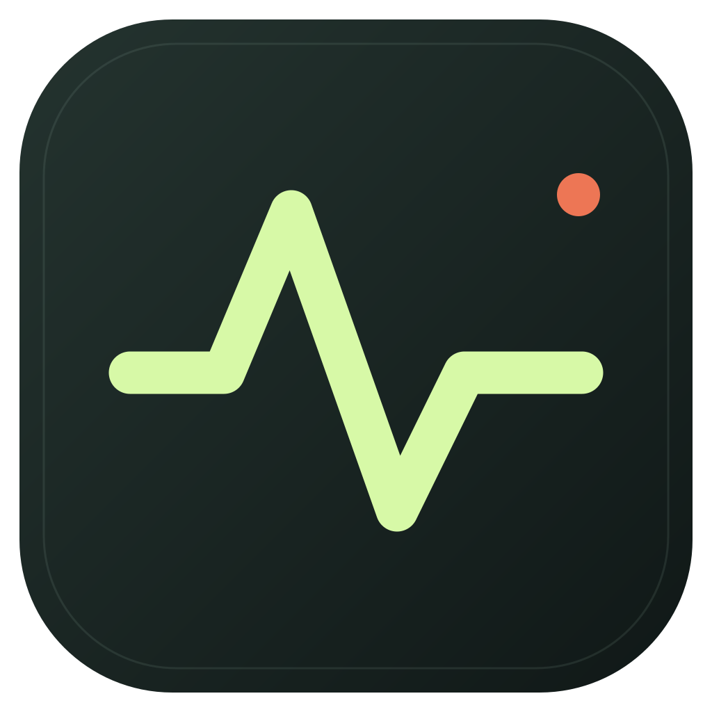
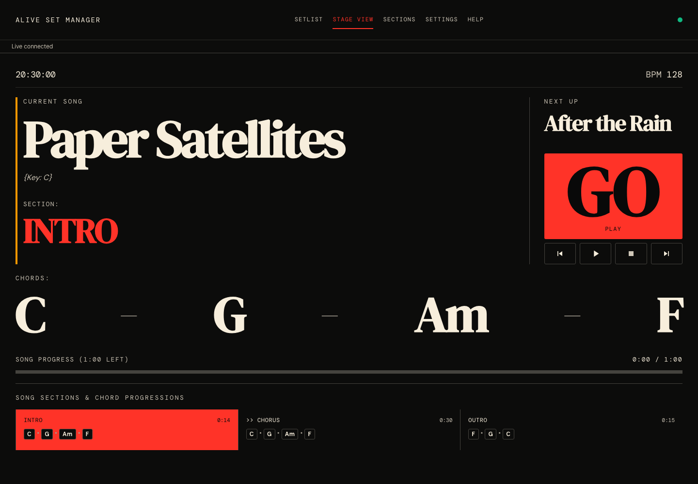
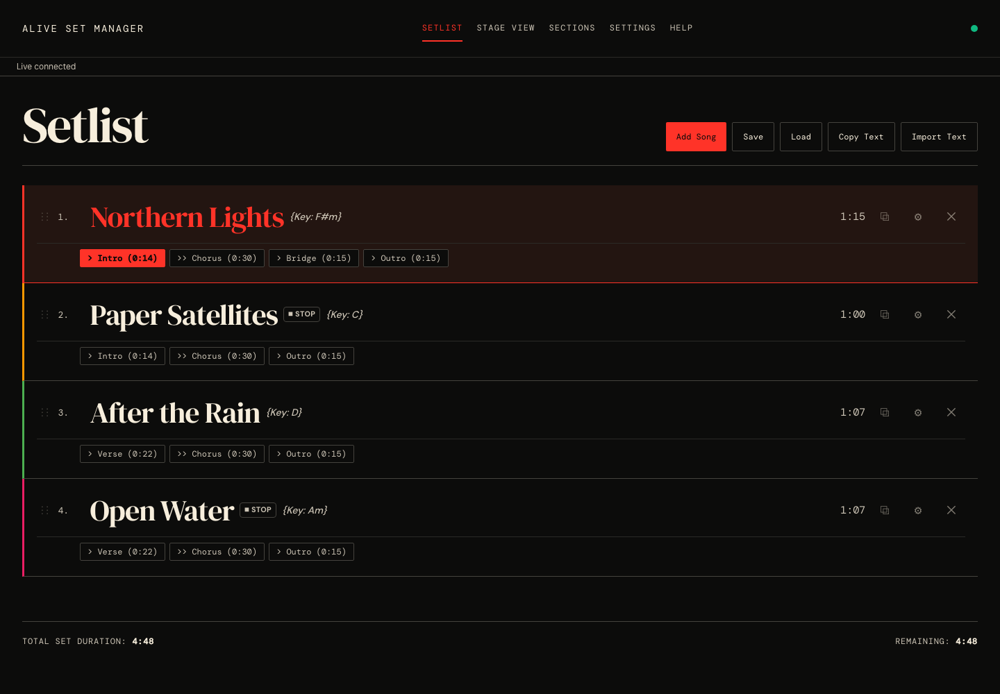
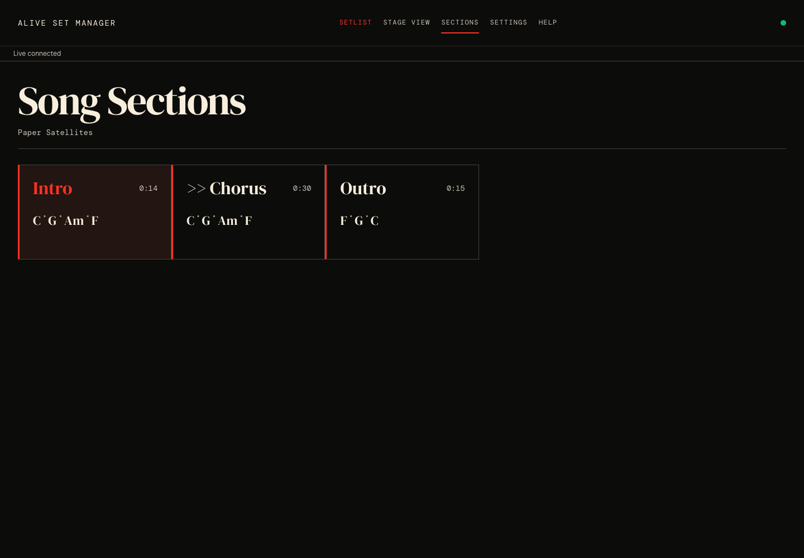
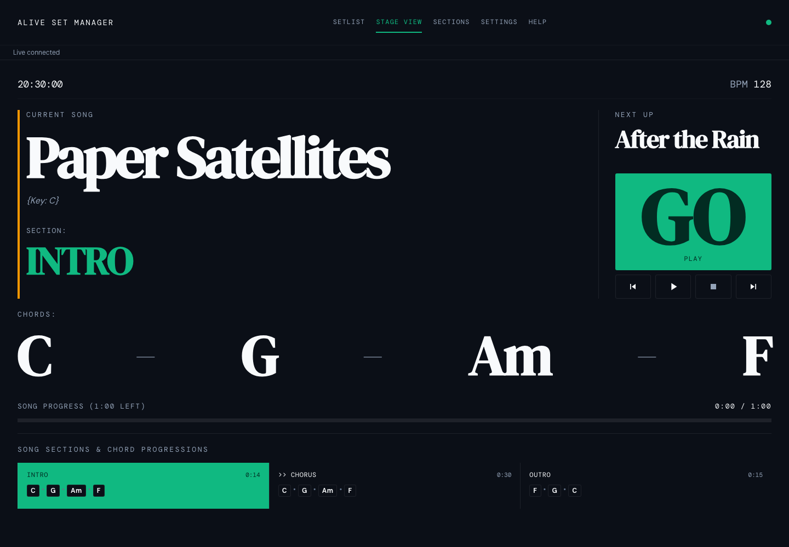
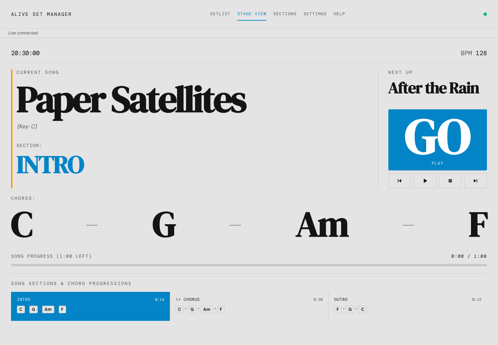
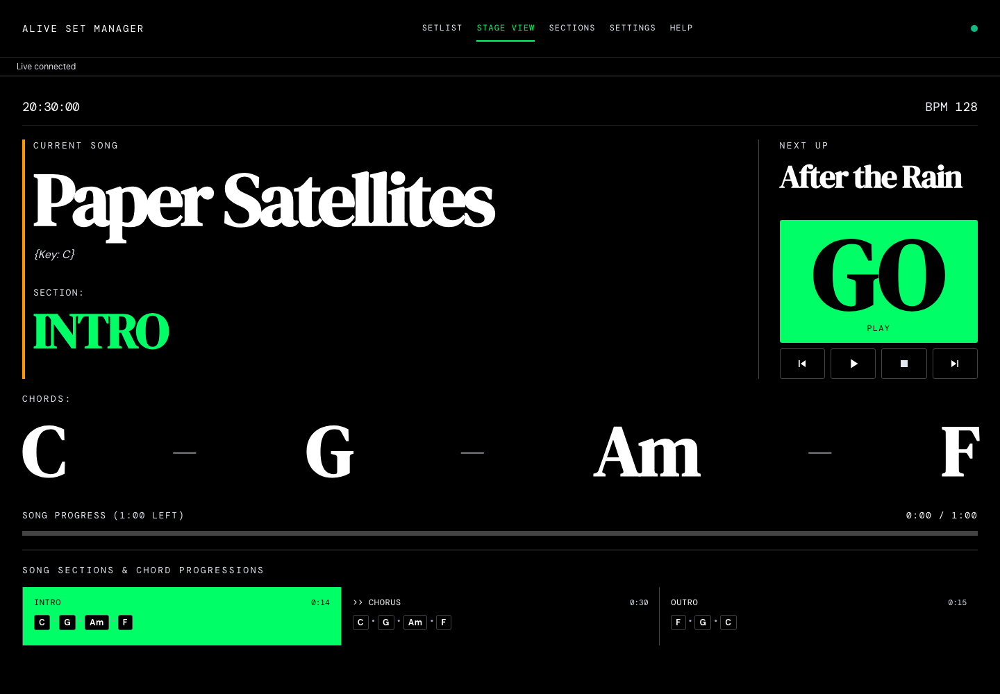
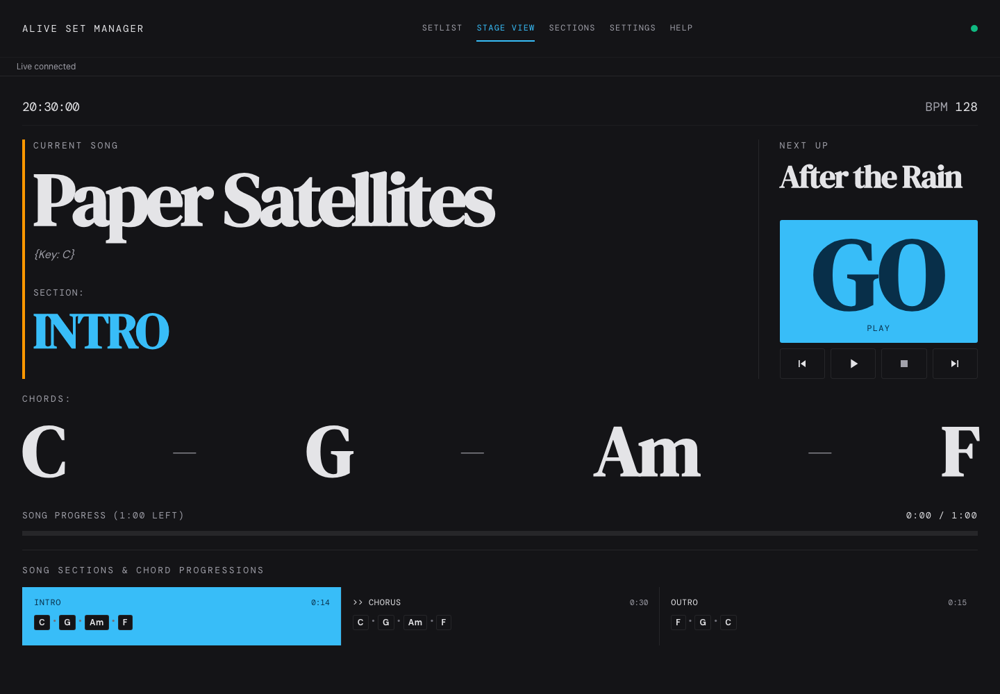
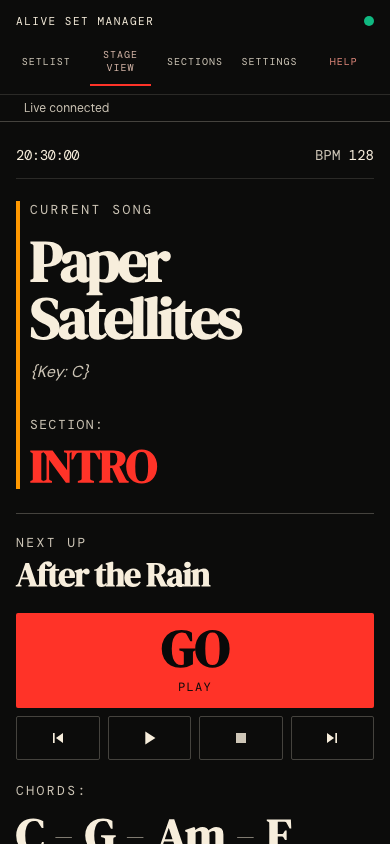

<p align="center"></p>
<h1 align="center">Alive Set Manager</h1>
<p align="center">Your arrangement. Your running order. One clear view on stage.</p>
<p align="center">
  <a href="https://github.com/joohnnyvv/alive-set-manager/actions/workflows/verify.yml"></a>
  
  
</p>
<p align="center"><a href="https://github.com/joohnnyvv/alive-set-manager/releases"><strong>Downloads & release notes</strong></a> · <a href="docs/GETTING_STARTED.md">Get started</a> · <a href="https://github.com/joohnnyvv/alive-set-manager/issues">Report an issue</a></p>



A desktop setlist controller for **Ableton Live 12**, with a companion interface for phones and tablets on your local network. Arrange songs, see section chords, queue transitions, and map a MIDI pedal without losing sight of the performance.

> **First alpha in preparation.** Download links will become usable when the first draft is published. Builds are not publisher-signed or notarized. Rehearse and keep backups; this is not yet certified for unattended stage use. See the [acceptance record](docs/RELEASE_CHECKLIST.md) for what has actually been tested.

## Made for the set

- **Setlist:** reorder, duplicate, skip, restore, and save named running orders.
- **Stage View:** current song, section, chords, progress, next song, and a contextual GO button.
- **Sections:** quick navigation through your arrangement.
- **Five jump modes:** quantized, end of section, end of song, dynamic, and manual.
- **MIDI Learn:** map notes, control changes, and program changes to playback actions.
- **First-run setup:** install the bundled AbletonJS script into your User Library, with backups for replacements.
- **Offline essentials:** fonts, setup instructions, help, and license notices live inside the app.
- **Updates on your terms:** check releases and download manually; the alpha never restarts a performance to update.

| Setlist | Sections |
| --- | --- |
|  |  |

## Five views of the same stage

All screenshots use the same original demo arrangement and actual application UI.

| Midnight | Live Dark |
| --- | --- |
|  |  |

| Live Light | High Contrast |
| --- | --- |
|  |  |

| Soft Dark | Mobile Stage View |
| --- | --- |
|  |  |

## Install and connect

1. Choose the download matching your computer from [Releases](https://github.com/joohnnyvv/alive-set-manager/releases).
2. **macOS:** open the DMG and drag the app into Applications. **Windows:** run the per-user installer. No Node.js installation is needed.
3. Open **Help → Connect Ableton Live 12**. Confirm your User Library and install AbletonJS. Existing replacements are backed up outside Live’s Remote Scripts folder.
4. In Live’s **Settings → Link, Tempo & MIDI**, choose **AbletonJS** as a Control Surface, with Input and Output set to **None**. Restart Live if necessary.
5. Add song and section locators to your arrangement. The app reports its own connection and Live’s connection separately.

```text
Northern Lights {Key: F#m} [blue]
> Intro {F#m D A E}
>> Chorus {F#m D A E}
> Bridge +LOOP:2
> Outro
SONG END
Paper Satellites
> Verse {C G Am F}
STOP
```

Place each locator at its intended beat; this example is a naming guide, not an audio file. [Full setup and locator guide →](docs/GETTING_STARTED.md)

### Compatibility

| Target | Download | Status |
| --- | --- | --- |
| macOS, Apple Silicon | arm64 DMG / ZIP | Local packaged smoke testing; real-hardware acceptance tracked separately |
| macOS, Intel | x64 DMG / ZIP | CI build and smoke gate; not locally verified |
| Windows, x64 | NSIS installer | CI build and smoke gate; clean-machine acceptance pending |
| Ableton Live 12 | Bundled AbletonJS 4.1.0 | Intended compatibility target; see acceptance record |
| Live 11 / Linux | — | Unverified / not supported by this alpha |

Unsigned downloads may prompt OS warnings. Verify the release checksum and source before following your OS’s documented approval process. macOS may require **System Settings → Privacy & Security → Open Anyway** after an initial blocked launch; managed computers may prohibit unsigned apps. Do not disable system protections globally. Windows may show an unknown-publisher warning.

### Phones and tablets

Enable **Local network access** in Settings, restart the desktop app, and scan its QR code from a device on the same trusted Wi-Fi. Keep the server off the public internet. Wake Lock and clipboard capabilities depend on the browser and secure-context rules; ordinary LAN HTTP is not a full offline PWA.

## Develop and test

Use Node 24 and npm. The lockfile is the source of dependency versions.

```sh
npm ci
npm run dev             # frontend: http://localhost:5173
npm run typecheck
npm test                # isolated storage, no Live or MIDI hardware required
npm run build
npx playwright install chromium
npm run test:e2e        # real backend + simulated Live/MIDI
npm run pack:mac        # macOS application bundle, never publishes
```

`npm run demo` serves the built UI at `http://127.0.0.1:4173` with temporary sample data. `npm run screenshots` refreshes the gallery. Desktop setup and update controls are available only in Electron.

[Development and test guide](docs/DEVELOPMENT.md) · [Release process](docs/RELEASING.md) · [Changelog](CHANGELOG.md) · [Contributing](CONTRIBUTING.md) · [Security](SECURITY.md)

## License and acknowledgments

Alive Set Manager is released under the [ISC license](LICENSE). It uses [AbletonJS by Leo Bernard](https://github.com/leolabs/ableton-js), Electron, Solid, native MIDI/RtMidi, and other open-source components. The app bundles complete third-party notices and a generated dependency inventory. [License review and generation details](docs/LICENSES.md)

Independent project; not affiliated with or endorsed by Ableton or AbleSet. Ableton Live is required and is not included.
